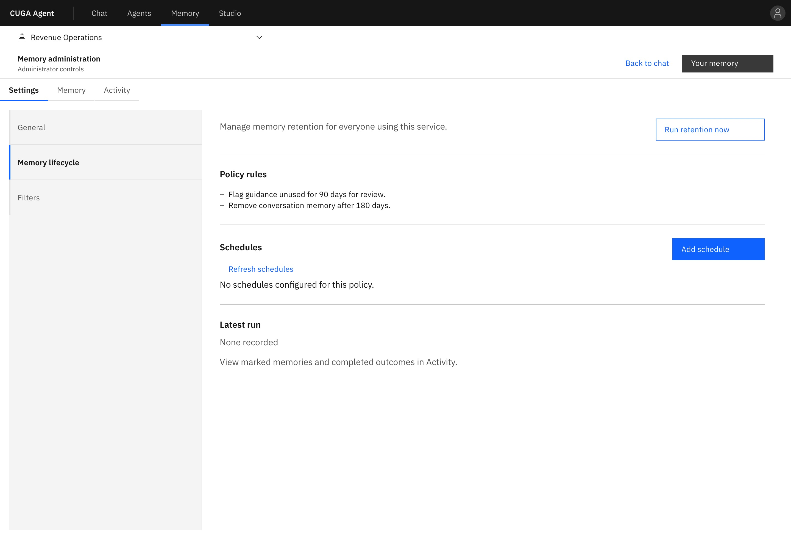

# README media

The README uses direct product screenshots and a browser recording of CUGA's interface. The files are stored in the repository so readers can inspect or download them.

| Asset | Content |
| --- | --- |
| `../images/readme/hero.svg` and `hero-mobile.svg` | Existing editable introduction to sovereignty, execution policies, and inference efficiency. |
| `../images/readme/manager.jpg` | Configuration workspace with connected CRM and Workspace tools, draft chat, and Publish. |
| `../images/readme/policies.jpg` | Tool Approval policy configuration with sample CRM rules. |
| `../images/readme/agents.jpg` | Dashboard with Revenue Operations, Knowledge Assistant, and Operations Supervisor. |
| `../images/readme/chat.jpg` | Chat workspace for the sample Revenue Operations agent. |
| `../images/readme/events.jpg` | Events Studio with sample scheduled workflows and illustrative run history. |
| `../images/readme/memory.jpg` | Memory workspace with sample guidance, preferences, sources, and usage. |
| `../images/readme/memory-retention.jpg` | Memory administration with sample retention rules. |
| [Product walkthrough](../images/readme/product-tour.mp4) | Approximately 30 seconds of direct browser recording, 1440 × 1000, silent H.264. |
| [English captions](../images/readme/product-tour.vtt) | Descriptions of the interface actions shown in the recording. |
| [Walkthrough steps](product-tour.md) | Text equivalent of the recorded sequence. |
| [media-fixture.json](media-fixture.json) | Illustrative data used for the screenshots and recording. |

## What these visuals represent

Screenshots were captured on November 1, 2026 from the packaged frontend at `3991f5a22`, whose frontend files match main at `e935697d8`. They use a 1440 × 1000 browser viewport, or 1440 × 1280 for the dashboard and Events Studio, at a device scale factor of 2. JPEGs are saved directly at native resolution.

The video is a continuous browser recording of that same interface at 1440 × 1000. It shows agent search, opening the configuration, connected tools, approval policies, chat, knowledge controls, memory, and Events Studio. The brief initial blank browser frame is trimmed; the interface interactions are preserved at their recorded speed.

The screenshots and recording use the existing Revenue Operations fixture above. Internal endpoints, model names, policy names, tool counts, version numbers, workflows, run statuses, memory records, usage counts, and retention settings are examples. No model inference, flow execution, channel delivery, retention operation, or business-tool connection was performed. This is an interface walkthrough, not a completed agent task.

Both header graphics retain the original [CUGA owl logo](../../src/frontend_workspaces/extension/src/assets/cuga-logo.png), embedded without changing its artwork.

## Memory retention controls

The sample rules flag unused guidance after 90 days and remove conversation memory after 180 days. No retention operation was run. Availability depends on the backend; durable retention uses PostgreSQL and the bundled Evolve HTTP service.

## Refresh the captures

1. Build the frontend using the [workspace instructions](../../src/frontend_workspaces/README.md), or serve the packaged build from `src/cuga/frontend/dist`.
2. Use an isolated fixture service with sample data and no credentials or private records. The JSON fixture above documents these examples.
3. Capture `/manage`, `/manage/revenue-ops`, the Tool Approval configuration dialog, `/studio`, and `/chat/revenue-ops`. Open **Memory**, then **Administration → Memory lifecycle** for retention controls.
4. Wait for data and fonts. Inspect every capture for empty content, clipped controls, unwanted focus outlines, and errors. Save screenshot bytes at native resolution.
5. Record the actual interface interactions when updating the walkthrough. Keep the action descriptions and text equivalent aligned with the video. Preserve the sample-data disclosure.
6. Keep matching product media in `cuga-project/landing-site` synchronized. The website serves its own files, so the two PRs can merge independently. Verify playback, descriptions, dismissal, and focus restoration on desktop and mobile.
